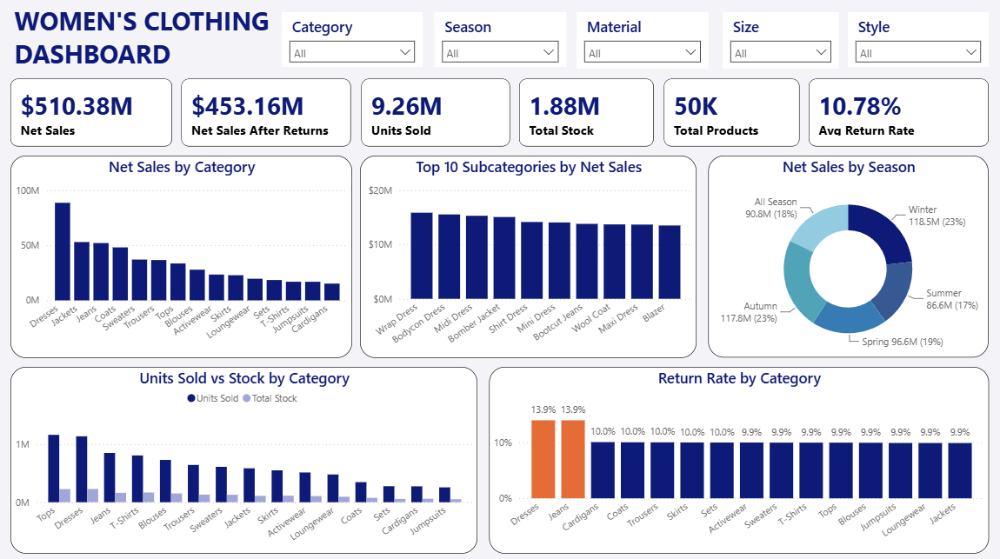

# Women's Clothing Sales Dashboard

An interactive Power BI dashboard analysing sales, stock and returns for a 50,000-product women's clothing dataset.



## Key Metrics

| Metric | Value |
|---|---|
| Net Sales | $510.38M |
| Net Sales After Returns | $453.16M |
| Units Sold | 9.26M |
| Total Stock | 1.88M |
| Total Products | 50K |
| Avg Return Rate | 10.78% |

## Dashboard Features

- **Filters (slicers):** Category, Season, Material, Size, Style
- **Net Sales by Category:** Dresses lead, followed by Jackets, Jeans and Coats
- **Top 10 Subcategories by Net Sales:** Wrap Dress, Bodycon Dress and Midi Dress lead
- **Net Sales by Season:** Winter and Autumn are the biggest seasons (23% each)
- **Units Sold vs Stock by Category:** compares demand against inventory
- **Return Rate by Category:** Dresses and Jeans stand out at 13.9%

## Dataset

`women_clothing_50k.csv` has 50,000 rows and 15 columns:

| Column | Description |
|---|---|
| product_id | Unique product ID |
| category / subcategory | Product grouping |
| material, color, size | Product attributes |
| season, style | Seasonality and style type |
| price_usd | Price in US dollars |
| discount_percent | Discount applied |
| rating, review_count | Customer feedback |
| stock_quantity | Units in stock |
| units_sold | Units sold |
| return_rate | Share of units returned |

## Insights

- Dresses generate the highest net sales and, along with Jeans, have the highest return rate (13.9%).
- Roughly $57M of sales is lost to returns (Net Sales vs Net Sales After Returns).
- Winter and Autumn together account for 46% of net sales.

## Tools Used

- Power BI (dashboard and DAX measures)
- CSV dataset

## Repository Contents

```
├── README.md
├── dashboard.png
├── women_clothing_50k.csv
└── Women_Clothing_Dashboard.pbix
```

## How to Use

1. Download this repository.
2. Open the `.pbix` file in Power BI Desktop.
3. If asked, point the data source to `women_clothing_50k.csv`.
